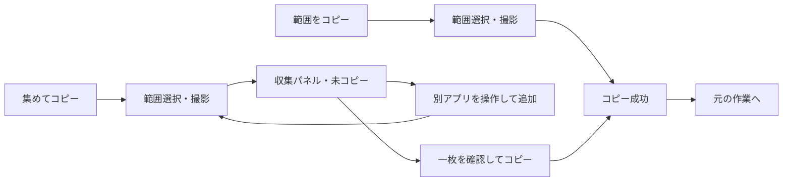

# OneClip プロダクト・開発計画

必要なところを集めて、ひと貼りで伝える。

この文書は仕様・優先順位・工程・受入条件の正本です。実装状態はソースと[検証要約](M4-VERIFICATION.md)で確認します。
M0〜M3は限定条件で完了、M4の追加評価と対象Collection VoiceOverは保留です。
ソース公開はMITによる開発中の先行公開であり、公開v1の品質合格やM5/M6全体の完了を意味しません。
個人の操作・会話・認証の経緯、私用環境や内部履歴は公開文書へ含めません。

## 1. 目的・対象・差別化

### 1.1 届ける体験

Macでチャット・AI相談・不具合報告をする人が、説明に必要な画面の部分を取り出し、
必要なら複数箇所を一枚にまとめ、読める画像を一度の貼り付けで相手へ示せる。
通常の一箇所共有では、範囲を選び終えたらすぐコピーされ、元の作業へ戻れる。

優先順位は、**意図した内容の確実なコピー → 文字の読みやすさと順序 → 安全な取消・復帰 → 操作の少なさ**。
必要情報が欠けず、相手が説明の箇所を追えることまで確認する。AIの回答品質、相手の理解そのもの、
貼り付け先の受入れをアプリが保証するとは説明しない。

| 場面 | 渡したいもの | 最初に確かめる価値 |
| --- | --- | --- |
| U1 一箇所の共有 | エラーや画面の一部をチャットに貼る | 確認画面や保存先選択なしで迷わず貼れる |
| U2 エラーと設定 | エラー表示と別画面の関連設定 | 何枚も貼り直さず、一枚で関係を説明できる |
| U3 変更前後 | 変更前を撮り、操作してから変更後を撮る | 順序が保たれ、両方の内容が読める |
| U4 全体と細部 | 全体像と離れた箇所・拡大表示 | 必要な内容が欠けず、見る場所を指定できる |

公開v1の体験ゲートはU1〜U3。U4は探索用途として観察し、独立した必須ゲートにはしない。

OneClipはmacOS用の範囲選択・クリップボードアプリとして、単発コピーとまとめ撮りを提供する。
手動で隠す機能は後続候補。枚数・配置・キー・工程は以下の採用設計に従う。

### 1.2 立ち位置と比較案

| 一次資料で確認した選択肢 | 既存の強み | OneClipで検証する問い |
| --- | --- | --- |
| [macOS標準](https://support.apple.com/en-gb/102646) | 範囲撮影と直接コピー | U1で追加アプリを使う価値があるか |
| [Shottr](https://shottr.cc/) | 軽量、OCR、注釈、画像結合・リサイズ | U2/U3を選択からコピーまで少ない迷い・手数で終えられるか |
| [CleanShot X](https://cleanshot.com/) | 撮影・編集・録画・共有の広い機能 | 一箇所・数箇所を共有する導線を絞る価値があるか |
| [Flameshot](https://flameshot.org/) | OSS、範囲選択、注釈 | OSSという属性に加え、説明用画像の作り方で選ばれるか |

画像結合、軽量、コピー、OSSはそれぞれ既存の選択肢がある。比較表は設計上の参考であり、最新の製品仕様は各公式サイトで確認する。
**U1を重くせずU2/U3を一続きで終えられることが差別化仮説**。
競合の実操作比較、性能測定、人間の評価は未実施。最速・最小メモリ等の優位は宣言しない。

| 選択肢 | 評価と採否 | 見直す条件 |
| --- | --- | --- |
| 単発だけを維持 | 小さく作れるがまとめ撮りの価値を試せない。先行alphaとして採用 | 単発の使いやすさ自体が成立しなければ先に修正 |
| 毎回プレビューし追加を選ばせる | 単発でも判断が増える。採らない | 単発でも常に確認したい需要が判明した場合 |
| 単発とまとめ撮りを別の明示入口にする | 普段の速さと収集中の確認を分けられる。採用 | 二つの入口を繰り返し取り違える場合 |
| 汎用編集・OCR・AI接続を増やす | 主用途に対する操作・保守・権限負担が大きい。後へ回す | 共有作業の障害として継続的な根拠が得られた場合 |

維持：メニューバー、範囲選択、直接コピー、取消・失敗保護。
変更：公開v1にまとめ撮りと「文字が読める」を加える。統合：権限・選択・撮影・コピーを共通化。
削減：履歴、自由編集、外部送信などを初版へ混ぜない。

## 2. 成果物の範囲と要件

### 2.1 版ごとの約束

| 到達点 | 含めるもの | 完成表示の条件 |
| --- | --- | --- |
| M1 単発の縦通し | 既許可状態の限定環境で完了。メニュー単発撮影・取消・基本失敗を実装 | 内部試験と実取得/貼付けの結果を区別。M2の単発alphaとは区別 |
| 単発alpha | 単発撮影・コピー、権限復帰、ホットキー、取消・失敗 | まとめ撮り未実装を明記。差別化完成版とは扱わない |
| まとめ撮りbeta | 単発＋複数箇所の収集・確認・一枚への結合 | 上限・途中失敗・取り直しを含む操作を検証 |
| 公開v1候補 | 両撮影、宣言する環境の検証、利用文書 | M4の動作・体験・回帰の条件を満たす |
| OSSソース公開 | ライセンス・貢献方法・クリーンビルド手順等 | M5の公開条件と明示的な公開許可を満たす |
| 一般向けアプリ配布 | 正式署名・公証・配布パッケージ | M6の配布条件と明示的な配布許可を満たす |

ソースの先行alpha公開は公開v1と区別する。[先行ソース公開の条件](PUBLICATION.md)を満たしても、別環境検証を含むM5全体の完了とはしない。公開済みかどうかはGitHubの実状態で判断する。

### 2.2 公開v1の要件

| ID | 要件 | 主な受入条件 |
| --- | --- | --- |
| R01 | 範囲をコピー | メニュー／設定したキー→範囲選択→画像生成→コピー。毎回の確認パネルを挟まない |
| R02 | 集めてコピー | 明示入口から同じセッションへ最大4枚を順に取得し、一枚のPNGとしてコピー |
| R03 | 収集中の確認 | 枚数・未コピー・撮影順・完成プレビュー。追加・個別削除・同じ順番の素材の取り直しができる |
| R04 | 一度の確定 | 収集途中は書かず最後の確定時だけ完成画像を書く。複数画像アイテムを並べて渡さない |
| R05 | 取消・失敗の分離 | 選択取消、全体破棄、追加失敗、合成失敗、書込み失敗の結果を区別 |
| R06 | 呼び出しと復帰 | 他アプリ前面から呼び出し、二重開始を防ぐ。Enter/Esc非横取り、外部作業への復帰 |
| R07 | 必要な時だけ権限案内 | 起動直後は要求せず、未許可・拒否・許可後復帰・取消に対応。権限変更から勝手に撮影しない。単発の許可画面は短文と主操作を先に示し、設定/許可済みの手順を段階表示する（[検証状況](M4-VERIFICATION.md#m4-status)） |
| R08 | 画面と画質 | 各ディスプレイで撮影し異倍率素材も結合。無断切捨て・伸張・縮小なし |
| R09 | 上限と応答 | 枚数・画素・寸法・画像バッファの上限を検査。超過時も既存素材を保持しUIを固めない |
| R10 | データの扱い | アプリによる画像ファイル保存・履歴・通信・画面内容ログなし。終了したセッションの復元なし |
| R11 | 操作とアクセシビリティ | メニュー・パネル・フォーカス・状態通知をキーボード／VoiceOverで検証。範囲指定の代替はD04で確定。公開v1の要件は維持し、対象Collection VoiceOverは未実証・保留とし、M3の限定完了を全面アクセシビリティ合格へ広げない |
| R12 | 公開と再現性 | 宣言する対応環境、既知の制約、ライセンス、第三者のビルド・配布物試験を記録 |

最大4枚は短い説明用画像に集中するための初期上限。無制限な画像結合は対象外とする。
まとめ撮りで1枚だけコピーすることも許可する。空ならコピーを無効にする。

### 2.3 v1に含めないもの

自動貼り付け、AI接続・送信、自動秘匿、OCR、録画、スクロール自動継ぎ合わせ、画像履歴、ファイル保存、
クラウド、自由な注釈・並べ替え・配置、キャプション、ログイン起動、自動更新、App Store配布。
一度のドラッグで複数ディスプレイをまたぐ撮影、HDR画質保証も含めない。

手動マスクはv1後の候補。不透明矩形を第一案とし、コピーされる最終ピクセルへ反映することを条件にする。
元画像・編集レイヤーを出力に含めず、通常の即コピーを「秘密情報を常に防ぐ」と説明しない。

## 3. 操作・画面・状態

### 3.1 入口と初回

メニューは「範囲をコピー」「集めてコピー…」「設定…」「OneClipを終了」が基本。
公開v1では二つの撮影に別々のキーを任意設定する。M2は単発だけを登録し、集めてコピーのキーと相互作用はM3で実装・検証する。キー未設定でもメニューで利用できる。
標準スクショの割当を自動変更しない。具体的なキーはD01で検証して決める。
M2の初期値は未設定。Control/Option/Commandの1つ以上を必須とし、Enter/Esc等と既知の標準操作の重複は案内して拒否する。OS登録成功を全アプリとの無衝突保証にしない。新登録・旧解除が揃ってから表示/保存を採用し、復元/解除/rollback失敗時は残登録を追跡して希望キーと実効状態を区別する。設定・収録・初回案内・破棄/終了確認中は共通gateで撮影を抑止する。保存はキーと案内既読だけで、画像/セッション/範囲/操作履歴は含めない。

設定は撮影ごとのカードで、用途・現在のキー・変更操作をまとめる。円形アイコンの青／青緑は役割の補助とし、名称や状態も併記する。余白と柔らかな面で情報を区切り、ライト／ダークに適応する。高コントラスト時にはカードとキートップの輪郭を強める。通常の説明は折り畳み、未登録・失敗・解除待ちの理由と復旧操作は表示する（R06／R11、D01、T08／T10）。

単発は撮影後にセッションパネルを出さない。まとめ撮りの利用後も通常の単発動作を変えない。
最初の撮影操作で範囲確定によるクリップボード置換・ドラッグ/キー操作・取消を案内し、「範囲選択を始める」で既読を保存する。起動だけでは撮影/権限要求しない。初回の書込み成功時だけ「Command + Vで貼り付け」を補足し、成功時に既読保存する。反復は追加確認/プレビューなし。
まとめ撮り入口は「必要な部分を順に撮り、1枚にしてコピー」。1枚目取得後に別アプリへ移動できることを伝える。

### 3.2 代表フロー

各追加はその時点の画面を別々に取得する。変更前を撮り、アプリを操作して変更後を撮れる。
同時撮影、自動スクロール、重複除去、時間的整合性は保証しない。
初期方式は選択確定後に自分のUIを除いて撮影する案。動く画面は選択中と変わる可能性がありD02で実証する。

### 3.3 状態ごとの動作

| 状態 | 操作・結果 | 取消・失敗 |
| --- | --- | --- |
| 待機 | 選んだ入口へ進む | 終了しても権限要求やクリップボード操作なし |
| 権限確認 | 理由とOSの導線、明示的な再試行 | 拒否・戻る→待機。収集素材があればパネルへ戻す |
| 単発選択 | 範囲確定→取得→コピー。ゼロ面積は確定しない | Esc→待機。取消・取得失敗では書込みなし |
| まとめ撮り初回選択 | 成功→素材1枚のパネル | Esc→待機。失敗は理由と再試行先を示す |
| 収集パネル | 枚数、未コピー、素材と完成プレビュー。追加・コピー・削除・取り直し・破棄 | 他アプリの操作は自由。空なら追加可能・コピー不可 |
| 追加選択 | 成功した画像だけ末尾へ追加 | Esc／失敗→既存素材を保ったパネル。部分コピーなし |
| 取り直し選択 | 対象番号を示し、成功時だけ同じ位置を置換 | Esc／失敗では旧素材を保持。先に削除しない |
| プレビュー拡大 | 全体縮小と100%表示を切替え、内容を確認する | 戻る／Escで通常パネル。素材を破棄せず、Enterでコピーしない |
| 合成・エンコード | UIを止めず「画像を準備中…」。重複処理なし | 取消・失敗→素材を保ったパネル。書込みなし |
| 書込み | 完成データを一度だけ渡す。連打不可 | 書込み中は取消不可。失敗→素材保持で再試行／破棄 |
| 成功 | 成功表示→セッション終了→直近の外部作業へ | アプリ内の参照解放後もコピー済み画像は貼れる |
| 全体破棄確認 | 「今回のn枚を破棄しますか」。続けるが既定 | Escも続ける。破棄確定で参照解放、書込みなし |

パネルのEsc／閉じるは素材があれば全体破棄確認、空なら終了。
個別削除は指定素材だけを除き番号を詰める。履歴・削除後の復元は持たず、取り直しとは別操作にする。
取り直しは素材の並び順を維持し、新しい範囲を指定する操作。前回の画面座標を自動再利用しない。
個別削除では対象番号と復元不能を示して確認する。既定/Enter/Escは保持、明示削除だけを確定する。主導線へは確認を増やさない。実装と限定検証の状況は[M3検証要約](M3-VERIFICATION.md)を参照する。
通常のアプリ終了は未コピー素材があれば破棄確認。OS終了・クラッシュでは自動復元しない。
ロック／スリープ／セッション離脱時の非表示・破棄はD06で確定し、完全消去を未検証で約束しない。

### 3.4 キー、フォーカス、連打

- 収集待機中のまとめ撮りキーは追加。4枚ならパネルを示し、追加不可の理由を案内。
- 収集中の通常撮影キーは既存パネルを示す。無言の破棄・コピー・モード変換なし。
- 選択・取得・合成・書込み中は二重開始しない。破棄した処理の遅い結果で再開しない。
- Enterによるコピーは通常の収集待機中だけ。パネルの既定操作またはコピーにフォーカスがある時に限る。
  個別操作へフォーカスがあればその操作を優先し、コピーへ伝播させない。取得・合成・書込み・拡大表示中はEnterでコピーしない。
  破棄確認ではEnterも「続ける」。確認UIを最優先し、背面のコピーやホットキーを発火させない。
  Escは状態ごとの規則に従い、他アプリ前面でEnter/Escを横取りしない。キーの衝突と登録解除を検証する。
- 復帰先は撮影元に固定せず、パネルへ戻る直前まで利用者が操作していた直近の外部アプリへ更新する。
  復帰用のアプリ参照だけをメモリに持ち、ウィンドウ内容や操作履歴を記録しない。
  取得完了時にOneClipが前面ならパネルへ、最終成功時もOneClipが前面なら復帰先へ戻す。
  非同期処理中に利用者が別アプリへ移っていたら、そのまま操作を続けられるようフォーカスを奪わない。
  復帰先がなくても別アプリを勝手に起動せず、自動貼り付けもしない。

選択矩形はドラッグ開始画面の境界までに制限し、境界と「1つの画面内で選択」を選択中に示す。
ポインタを境界外で離した場合は撮影せず選び直せる状態へ戻す。切り詰めた画像を黙って確定しない。
別画面の素材は追加操作で取得し直す。選択範囲と実際の出力が一致することをT01で検証する。

### 3.5 パネルと情報の優先順位

非モーダルの小さなパネルに完成プレビュー、撮影順の素材一覧、「n/4枚・未コピー」、追加とコピーを置く。
個別削除・取り直し・全体破棄は副操作。1枚でも同じ確認導線を利用できる。
プレビューは同じパネルを一時展開して実寸確認できる形とし、別の汎用編集画面は作らない。
全体縮小と、1画像ピクセルを1表示ピクセルに対応させる100%表示を区別し、D03で倍率・操作を実証する。
拡大表示の「戻る」またはEscは通常パネルへ戻り、全体破棄には進まない。
小さいプレビューの存在だけで確認可能とせず、文字を含むU2/U3で可読性を確かめる。

選択中は範囲境界→取消／戻る→取得済み枚数の順で目立たせ、パネル・オーバーレイを撮影へ混入させない。
成功表示は短い非アクティブ表示と必要なアクセシビリティ通知にし、表示のためにフォーカスを再取得しない。
反復時の貼り付けを待たせず、失敗は段階・素材保持の有無・再試行先を伝える。
色や音だけに依存しない。素材に番号・寸法・操作の読み上げラベルを付け、フォーカス順を固定する。

## 4. 一枚にまとめる出力契約

| 項目 | 初期の採用設計 | 検証・見直し |
| --- | --- | --- |
| 形式 | 一枚のPNG。単一pasteboard itemへ完成画像を渡す | 貼付先への互換表現は同じ画像として必要時に追加 |
| 枚数 | 1〜4枚。1枚は余白・番号なしでその素材だけを出力 | 2〜4枚が代表。長画像を無制限に作らない |
| 順序 | 撮影順の縦一列 | 前後・左右の意味を推測しない。横並び・自由配置は後続 |
| 寸法 | 元ピクセル寸法を保持し左揃えでパディング | 幅を揃える拡大縮小・はみ出しの切捨てなし |
| 背景と間隔 | 2枚以上は白背景、外側16px、素材間16px、各素材前の番号欄24px | 初期値。小さい文字・暗い画像・貼付先の縮小をM0/M3で確認 |
| 番号 | 1、2…を画像外の番号欄へ描く | 変更前／後等の意味、日時、アプリ名を自動付与しない |
| 色 | SDR／sRGB／8bitが基本案 | 色変換を試験。可逆PNGでも変換後まで原画質のままとは説明しない |
| 倍率 | ポイント寸法・ピクセル寸法・倍率を別々に保持 | 1xと2xを等尺度と見なさず、D03で文字の見え方を判断 |
| コピー後 | OneClip終了後も貼れる完成データを渡す | 生存中だけ提供できる遅延データに依存しない |

2枚以上の出力は、幅=`最大素材幅+32`、高さ=`素材高の合計+24×枚数+16×(枚数−1)+32`を初期計算とする。
内容は再撮影時以外変更せず、配置・背景・番号と必要な色変換だけを加える。
貼付欄で長画像が縮小される場合は実寸表示も確認する。結合すれば必ず見やすいとは判断しない。

### 4.1 リソース上限

M0の初期試験値は**4枚、元画像合計24メガピクセル、完成画像24メガピクセル、最長辺16,384px、
見積もる画像バッファ予算384MiB**。単発にも寸法・画素・予算の検査を適用する。
製品確定値・プロセス全体のメモリ保証ではなく、M0のピーク測定で確定するD05の初期案。

撮影前に取得予定寸法、追加前・合成前・エンコード後に使用量を検査する。
追加・取り直しの候補を採用する前に、候補集合の余白・番号込みの完成寸法も計算する。
取り直し中に保持する旧素材と新素材の両方をピークへ含め、エンコード前の見積りと後の実データ量を検査する。
行バイト数×高さを基礎に、素材、取得中画像、色変換、context、完成画像、PNG、プレビューを見積もる。
PNG容量を展開メモリの代わりにせず、加算・乗算のオーバーフローを防ぐ。
超過時は追加／合成を止め、既存素材を保持して撮り直し・削除を案内する。
古い素材の自動削除・無断縮小・部分コピーなし。フル解像度の合成を同時に複数作らない。

## 5. 技術・データ・失敗の契約

### 5.1 基盤と責務

SwiftUI / AppKit、macOS 14以上、App Sandbox、外部パッケージなしを暫定維持。
ScreenCaptureKitのmacOS 14対応単発撮影APIを基本とし、継続録画ストリームは初期前提にしない。
新OS専用API、Sandbox無効化、依存追加、キー監視のためのアクセシビリティ権限は必要性と代替を比較して判断する。

| 責務案 | 処理 | 境界の検証 |
| --- | --- | --- |
| CaptureCoordinator | セッションと状態、入口・復帰 | 二重開始、取消、古い非同期結果の排除 |
| PermissionService / RegionSelector | 権限、範囲・画面の確定 | 拒否後復帰、座標・倍率、UI除外 |
| ScreenshotService | 指定時点の単発画像 | API availability、失敗・画面切断、バッファ解放 |
| CollectionSession | 順序付き素材、削除・置換、使用量 | 置換成功前の旧素材保持、上限、破棄 |
| ImageComposer | 配置計算、画像・プレビュー | 順序・無欠け・番号・画質・メモリ |
| ClipboardWriter | エンコード・書込み | 失敗の成功扱い防止、コピー結果の寿命 |
| HotKeyManager | 登録・変更・衝突・解除 | 他アプリ前面、競合、終了時の解除 |

名前は構成案。先に汎用フレームワークを作らず、UIから独立に検証できる境界を優先する。
合成・エンコードはUIを塞がず同時処理を制限。セッションIDと更新番号で破棄後・置換前の古い結果を排除する。

### 5.2 データの寿命とプライバシー

- 素材、プレビュー、完成画像、PNGはセッション中のメモリ上で扱い、画面内容をログ・Git・外部へ保存しない。
- 画像と寸法・倍率等の必要情報だけ保持し、ウィンドウ名・URL・元アプリの本文を収集しない。
- 選択開始ディスプレイ内で撮影。別画面の素材は別の追加操作で取得する。
- 成功・全体破棄・終了で参照を解放。自動保存、状態復元、クラッシュ添付、分析送信なし。
- 通常のアプリ切替では収集を継続。ロック等での扱いはD06を参照し、未決のまま公開条件を通さない。
- コピー結果はOSのクリップボードに残る。OSのswap、Universal Clipboard、クリップボード管理アプリ、貼付先を含む
  完全消去・端末外非流出を保証せず、アプリ自身の保存・送信範囲を説明する。

### 5.3 クリップボードと失敗

| 境界 | 約束と検証 |
| --- | --- |
| 選択中／収集中／追加失敗 | 書込みを開始せず、旧クリップボードへ触れない |
| 画像・合成・PNG生成失敗 | 素材保持で再試行先を示し、成功表示なし |
| 書込み開始前 | 完成データとセッションの一致を検査。他アプリの直前コピーはD07で方針を確定 |
| 書込み開始後の失敗 | clear→writeで旧内容の完全保持を保証しない。旧内容全体の読取り・復元は初期機能外 |
| 失敗後 | まとめ撮りは素材保持。単発も取得画像を一時的な失敗パネルへ保持し、再コピー／破棄を提供 |
| 成功 | 書込み結果に基づいて表示し素材解放。ユーザーが貼り付け済みであることとは区別 |

書込み失敗で旧内容が失われる可能性と回復方法をD07へ記録。失敗パネルも同じ保持・破棄規則を使う。
OSが取得できない保護コンテンツは制限として示し、検出可能な失敗と検出困難な画像内容を分ける。

## 6. 検証計画と合格条件

### 6.1 技術検証の対応表

| ID | 条件と確認 | 要件 |
| --- | --- | --- |
| T01 | 合成画面で範囲・倍率・向きが一致しUI混入なし。境界越えドラッグの案内・再選択と出力の一致 | R01 R08 |
| T02 | 捨ててもよいテキスト／画像を入れてEsc、拒否、撮影・追加・合成失敗。書込み前の不変を確認 | R04 R05 R07 |
| T03 | 1／2／4枚の順序・番号・余白・削除・同じ順番の素材置換・空・異倍率。再取得できない素材の誤削除も利用テストで確認 | R02 R03 R08 |
| T04 | 件数・画素・寸法・予算の境界、overflow、エンコード後超過。旧素材とUIが復帰可能 | R09 |
| T05 | 二重開始、破棄後の遅い結果、置換前の合成完了、連打を差替え可能なサービスで再現 | R05 R06 |
| T06 | 書込み失敗の成功表示なし、保持・再試行。他アプリ同時コピーとD07方針、書込み結果と実貼付けを区別。終了後の貼付け | R04 R05 R10 |
| T07 | 未許可・拒否・許可後復帰・権限取消、画面切断・構成変更、スリープ／ロック復帰 | R05 R07 R08 R10 |
| T08 | 他アプリ入力中の保持、キー衝突・解除。破棄確認のEnterは続ける、個別操作・拡大中にコピーしない。撮影後チャットへ移動→確定と処理中アプリ切替で焦点を奪わない。Spaces等 | R06 |
| T09 | ピークメモリ、取得・合成・コピー時間。反復で保持画像が増え続けない | R09 R10 |
| T10 | VoiceOver／キーボードの到達・通知・フォーカス、範囲選択代替、拡大・コントラスト等。対象Collection VoiceOverは未実証・保留。明示的な再開依頼後に総合判定へ向けて確認する | R11 |
| T11 | 最小/現行OS、宣言CPUで起動→単発→まとめ撮り→終了後貼付けを記録 | R01 R02 R12 |
| T12 | クリーンビルド、公開履歴点検、署名・公証・staple、実ダウンロード後のGatekeeperと初回操作 | R12 |

自動テストは座標・配置・上限・状態と失敗へ絞り、実機の権限・貼付けを代用しない。
架空の氏名・エラー・設定・コードの合成画面を使い、実画面・クリップボード内容を成果物へ残さない。
ピクセル検証は作成したテスト素材に限定し、実データのスクリーンショットをログへ添付しない。

### 6.2 対応環境と貼付先

Apple Siliconを最初の開発対象とする。macOS 14は暫定最小OSで、deployment target指定だけで対応確認済みとしない。
最小OSと開発時の現行OS、宣言する中間OSの状況を公開前の対応表へ残す。
Intel採否はD08で決定し、x86_64ビルド、Rosetta起動、Intel実機成功を別々に扱う。
複数画面は1x/2x、左右上下・負座標・縦画面・切断、異倍率素材の同一セッションを確認する。

貼付先の検証計画はローカル画像対応アプリと、必要に応じたブラウザの入力欄を対象にする。
例はPreview等とチャットの下書き。架空画像を使い、アップロードを伴う場合も対象と許可範囲を確認する。
自動送信はしない。縮小表示、実寸閲覧、順序・欠け、コピー後の寿命をそれぞれ確認する。

### 6.3 体験と差別化の検証

U1〜U3を同じ素材と目的で実行し、標準の直接コピー、適切に設定したShottrと比較する。
まとめ画像だけでなく、複数画像をそのまま貼る方法も比較対象。競合の設定を不便なままにしない。
説明・慣れる時間を揃え、順序を入れ替え、呼出しから貼付完了の時間、操作数、迷い、誤範囲、貼り直し、欠落を残す。

利用テストでは初回・反復を分け、架空画像を受け取る側が箇所の関係を説明できるかを確かめる。
一人の結果を一般化せず、観察行為と感想、AIの推測を分ける。
最低条件はU1でまとめ撮りの確認が増えず、U2/U3で情報・文字・順序が保たれ、利用者がやり直し方を理解して完了できること。
その上で手数・迷いが減るか、選ぶ理由が言えるかを判断。未測定の改善率や固定秒数は合格条件にしない。

U1が重くなれば入口へ、長画像が読めなければ枚数・配置へ戻る。
価値が確認できなければ機能数だけで公開v1完成とせず、設計変更または公開範囲を再判断する。

## 7. 工程と終了条件

| 工程 | 状況・対象 | 終了条件と境界 |
| --- | --- | --- |
| M0 限定試作 | 画像合成・範囲取得・書込み境界の限定試作は完了 | [要約](M0-VERIFICATION.md)。製品全体の合格にはしない |
| M1 範囲選択コピー | 基本経路は限定完了 | [要約](M1-VERIFICATION.md#m1-completion)。全OS・厳密画質・全面アクセシビリティは未確認 |
| M2 単発alpha | 単発コピー・任意キー・権限案内は限定完了 | [要約](M2-VERIFICATION.md#m2-completion)。権限状態の限定検証と同一プロセスの全遷移を区別 |
| M3 まとめ撮りbeta | 収集・編集・合成・明示コピーは限定完了 | [要約](M3-VERIFICATION.md#m3-completion)。対象Collection VoiceOverは未実証 |
| M4 安定性・使いやすさ | 追加評価は保留 | [状況](M4-VERIFICATION.md#m4-status)。回帰・可読性・資源・継続利用・宣言環境の総合判定は未完了 |
| M5 OSSソース公開準備 | MIT、ビルド・貢献・プライバシー・セキュリティ案内を用意して先行ソース公開 | [公開条件](PUBLICATION.md)。別環境のclone→build等は未実施として残す |
| M6 一般向け配布 | 未着手 | 配布識別子・契約・署名・公証・配布物・実ダウンロード経路の初回起動を別途確認 |

### 保留中の評価

M4と対象Collection VoiceOverの追加評価は、明示的な再開依頼まで開始しません。
自動入力の復旧、VMの準備、権限変更、追加計時、継続利用課題、最終受入を日付だけで再開しません。
個別に報告された不具合は、その依頼の範囲で扱います。
再開時は候補版と対象条件を固定し、正常系・失敗保持・取消・復帰・画像の可読性・資源使用を分けて確認します。
最小対象OS、CPU、画面倍率と配置、貼付先、VoiceOverは確認済み・未実施・対象外を区別します。
試験用サービスでの成功を実画面取得や製品全体の成功へ広げません。

## 8. 設計判断と見直し条件

| ID | 採用設計・残件 | 関連 |
| --- | --- | --- |
| D01 キー | 単発と収集を別々に任意設定。初期値は未設定。OS登録の成功と全アプリ無衝突を区別 | R06、T08 |
| D02 取得時点 | 選択確定後のScreenCaptureKit単発取得。動く画面・厳密な境界/色/倍率の同期は未実証 | R01 R08 |
| D03 合成尺度 | 撮影順の縦配置、元ピクセル保持、番号、1枚例外を採用。全画質条件は未実証 | R02 R03 R08 |
| D04 範囲指定代替 | ドラッグとキー調整。全面VoiceOverは未実証 | R11、T10 |
| D05 資源 | 4枚・24MP・16,384px・画像バッファ384MiBの初期上限。見積りをプロセスRSS保証にしない | R09、T04 T09 |
| D06 保持終了 | ロック・スリープ・セッション離脱・画面構成変更で同期失効し、古い結果を棄却。完全消去は保証しない | R05 R10、T07 |
| D07 書込み競合 | 同期prepare/write、currentHostOnly、直前競合検査。atomic保護や旧内容の完全保持・復元は保証しない | R04 R05、T06 |
| D08 OS/CPU | deployment targetはmacOS 14。実行検証とtarget指定を区別。最小OS・Intel等は未確認 | R12、T11 |
| D09 ライセンス・公開先 | MIT、著作権者TaigaShinohara、公開先TaigaShinohara/OneClip。公開対象と履歴を点検 | R12、T12 |
| D10 署名・配布 | 通常ビルドと配布署名を分離。正式識別子・契約・形式・費用・提出は未確定 | R07 R12、M6 |
| D11 マスク | v1後候補。コピーする最終ピクセルへの反映が条件 | R03 R08 R10 |
| D12 個別削除 | 対象番号と復元不能を確認。既定/Enter/Escは保持。指定素材だけを削除し再番号 | R03 R05、T03 |

初期値や仕様を変更する場合は、関連する要件・検証条件も同じ変更で更新します。

## 9. 開発・公開の進め方

1. 対象のR/T/Dとソースを照合し、目的に必要な変更だけを行う。
2. 架空素材と専用pasteboardで影響する境界を検証する。
3. 実機・権限・一般クリップボードを使う確認は、必要な範囲が許可された場合だけ行う。
4. 結果・限定条件・失敗・未実施・残件を公開向けの技術要約へ記載する。個人作業記録は含めない。
5. 公開リポジトリでは通常のブランチ・PR・レビュー・mergeで更新する。

公開v1候補と一般向けアプリ配布は、先行ソース公開から自動的に進めません。
詳細な公開点検は[PUBLICATION](PUBLICATION.md)、貢献方法は[CONTRIBUTING](../CONTRIBUTING.md)を参照してください。

## 10. 一次資料

- [ScreenCaptureKit](https://developer.apple.com/documentation/screencapturekit)
- [App Sandbox](https://developer.apple.com/documentation/security/app-sandbox)
- [macOSの画面収録アクセス](https://support.apple.com/guide/mac-help/control-access-to-screen-and-system-audio-recording-mchld6aa7d23/mac)
- [GitHubのライセンス案内](https://docs.github.com/en/repositories/managing-your-repositorys-settings-and-features/customizing-your-repository/licensing-a-repository)
