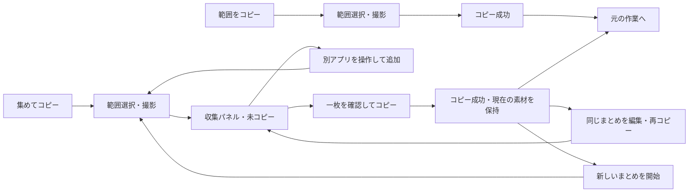

# OneClip プロダクト・開発計画

必要なところを集めて、ひと貼りで伝える。

この文書は仕様・優先順位・工程・受入条件の正本です。実装状態はソースと[検証要約](M4-VERIFICATION.md)で確認します。
M0〜M3は限定条件で完了、M4の追加評価と対象Collection VoiceOverは保留です。
ソース公開はMITによる開発中の先行公開であり、公開v1の品質合格やM5/M6全体の完了を意味しません。
個人の操作・会話・認証の経緯、私用環境や内部履歴は公開文書へ含めません。

## 1. 目的・対象・差別化

### 1.1 届ける体験

Macでチャット・AI相談・不具合報告をする人が、説明に必要な画面の部分を取り出し、
必要なら複数箇所を一枚にまとめ、読める画像を一度の貼り付けで相手へ示せる。
通常の一箇所共有では、範囲を選び終えたらすぐコピーされ、元の作業へ戻れる。

優先順位は、**意図した内容の確実なコピー → 文字の読みやすさと順序 → 安全な取消・復帰 → 操作の少なさ**。
必要情報が欠けず、相手が説明の箇所を追えることまで確認する。AIの回答品質、相手の理解そのもの、
貼り付け先の受入れをアプリが保証するとは説明しない。

| 場面 | 渡したいもの | 最初に確かめる価値 |
| --- | --- | --- |
| U1 一箇所の共有 | エラーや画面の一部をチャットに貼る | 確認画面や保存先選択なしで迷わず貼れる |
| U2 エラーと設定 | エラー表示と別画面の関連設定 | 何枚も貼り直さず、一枚で関係を説明できる |
| U3 変更前後 | 変更前を撮り、操作してから変更後を撮る | 順序が保たれ、両方の内容が読める |
| U4 全体と細部 | 全体像と離れた箇所・拡大表示 | 必要な内容が欠けず、見る場所を指定できる |

公開v1の体験ゲートはU1〜U3。U4は探索用途として観察し、独立した必須ゲートにはしない。

OneClipはmacOS用の範囲選択・クリップボードアプリとして、単発コピーとまとめ撮りを提供する。
収集パネルは素材を保持したまま隠して再表示できる。枚数・配置・キー・工程は以下の採用設計に従う。

### 1.2 立ち位置と比較案

| 一次資料で確認した選択肢 | 既存の強み | OneClipで検証する問い |
| --- | --- | --- |
| [macOS標準](https://support.apple.com/en-gb/102646) | 範囲撮影と直接コピー | U1で追加アプリを使う価値があるか |
| [Shottr](https://shottr.cc/) | 軽量、OCR、注釈、画像結合・リサイズ | U2/U3を選択からコピーまで少ない迷い・手数で終えられるか |
| [CleanShot X](https://cleanshot.com/) | 撮影・編集・録画・共有の広い機能 | 一箇所・数箇所を共有する導線を絞る価値があるか |
| [Flameshot](https://flameshot.org/) | OSS、範囲選択、注釈 | OSSという属性に加え、説明用画像の作り方で選ばれるか |

画像結合、軽量、コピー、OSSはそれぞれ既存の選択肢がある。比較表は設計上の参考であり、最新の製品仕様は各公式サイトで確認する。
**U1を重くせずU2/U3を一続きで終えられることが差別化仮説**。
競合の実操作比較、性能測定、人間の評価は未実施。最速・最小メモリ等の優位は宣言しない。

| 選択肢 | 評価と採否 | 見直す条件 |
| --- | --- | --- |
| 単発だけを維持 | 小さく作れるがまとめ撮りの価値を試せない。先行alphaとして採用 | 単発の使いやすさ自体が成立しなければ先に修正 |
| コピー前に毎回プレビューを確認させる | 単発でも判断が増えるため採らない。コピーと保存の後に非アクティブな小画像を表示する | 撮影後の確認・編集導線はD15で扱う |
| 単発とまとめ撮りを別の明示入口にする | 普段の速さと収集中の確認を分けられる。採用 | 二つの入口を繰り返し取り違える場合 |
| アプリ内の汎用編集・OCR・AI接続を増やす | 主用途に対する操作・保守・権限負担が大きい。画像編集は保存原本のコピーをmacOSの「プレビュー」で開く導線を採用 | OneClip内での編集が必要となった場合 |

維持：メニューバー、範囲選択、直接コピー、取消・失敗保護。
変更：公開v1にまとめ撮りと「文字が読める」を加える。統合：権限・選択・撮影・コピーを共通化。
削減：収集セッションの履歴・自動復元、アプリ内の自由編集、外部送信を初版へ混ぜない。完成PNGの保存と標準アプリへの編集導線はD15に従う。

## 2. 成果物の範囲と要件

### 2.1 版ごとの約束

| 到達点 | 含めるもの | 完成表示の条件 |
| --- | --- | --- |
| M1 単発の縦通し | 既許可状態の限定環境で完了。メニュー単発撮影・取消・基本失敗を実装 | 内部試験と実取得/貼付けの結果を区別。M2の単発alphaとは区別 |
| 単発alpha | 単発撮影・コピー、権限復帰、ホットキー、取消・失敗 | まとめ撮り未実装を明記。差別化完成版とは扱わない |
| まとめ撮りbeta | 単発＋複数箇所の収集・確認・一枚への結合 | 上限・途中失敗・取り直しを含む操作を検証 |
| 公開v1候補 | 両撮影、宣言する環境の検証、利用文書 | M4の動作・体験・回帰の条件を満たす |
| OSSソース公開 | ライセンス・貢献方法・クリーンビルド手順等 | M5の公開条件と明示的な公開許可を満たす |
| 一般向けアプリ配布 | 正式署名・公証・配布パッケージ | M6の配布条件と明示的な配布許可を満たす |

ソースの先行alpha公開は公開v1と区別する。[先行ソース公開の条件](PUBLICATION.md)を満たしても、別環境検証を含むM5全体の完了とはしない。公開済みかどうかはGitHubの実状態で判断する。

### 2.2 公開v1の要件

| ID | 要件 | 主な受入条件 |
| --- | --- | --- |
| R01 | 範囲をコピー | メニュー／設定したキー→範囲選択→画像生成→コピー。毎回の確認パネルを挟まない |
| R02 | 集めてコピー | 明示入口から同じセッションへ最大4枚を順に取得し、一枚のPNGとしてコピー |
| R03 | 収集中の確認 | 枚数・コピー後の変更有無・撮影順・小画像・完成プレビュー。追加・個別削除・新旧比較後の素材置換とコピー後の修正ができる |
| R04 | 一度の確定 | 収集途中は書かず最後の確定時だけ完成画像を書く。複数画像アイテムを並べて渡さない |
| R05 | 取消・失敗の分離 | 選択取消、全体破棄、追加失敗、合成失敗、書込み失敗の結果を区別 |
| R06 | 呼び出しと復帰 | 他アプリ前面から呼び出し、二重開始を防ぐ。Enter/Esc非横取り、外部作業への復帰 |
| R07 | 必要な時だけ権限案内 | 起動直後は要求せず、未許可・拒否・許可後復帰・取消に対応。権限変更から勝手に撮影しない。単発・まとめ撮りの許可画面は共通の状態表現を使い、短文と主操作を先に示して設定/許可済みの手順を段階表示する（[検証状況](M4-VERIFICATION.md#m4-status)） |
| R08 | 画面と画質 | 各ディスプレイで撮影し異倍率素材も結合。無断切捨て・伸張・縮小なし |
| R09 | 上限と応答 | 枚数・画素・寸法・画像バッファの上限を検査。超過時も既存素材を保持しUIを固めない |
| R10 | データの扱い | 単発撮影とまとめ完成コピー時のPNGをローカル自動保存。収集セッションの履歴・復元、通信・画面内容ログなし。保存ファイルは素材破棄・失効と別の寿命を持つ |
| R11 | 操作とアクセシビリティ | メニュー・パネル・フォーカス・状態通知をキーボード／VoiceOverで検証。範囲指定の代替はD04で確定。公開v1の要件は維持し、対象Collection VoiceOverは未実証・保留とし、M3の限定完了を全面アクセシビリティ合格へ広げない |
| R12 | 公開と再現性 | 宣言する対応環境、既知の制約、ライセンス、第三者のビルド・配布物試験を記録 |
| R13 | 撮影後の保存・プレビュー・編集 | コピーと保存を独立して実行し、右下へ8秒間の非アクティブな小画像を表示。閉じても保存維持。編集用コピーをmacOSの「プレビュー」で開き、保存原本を保持。メニューから最新画像の編集と保存フォルダ表示ができる |

最大4枚は短い説明用画像に集中するための初期上限。無制限な画像結合は対象外とする。
まとめ撮りで1枚だけコピーすることも許可する。空ならコピーを無効にする。

### 2.3 v1に含めないもの

自動貼り付け、AI接続・送信、自動秘匿、OCR、録画、スクロール自動継ぎ合わせ、収集セッションの履歴、
クラウド、アプリ内の自由な注釈・並べ替え・配置、キャプション、ログイン起動、自動更新、App Store配布。
完成PNGの自動保存と、macOSの「プレビュー」でのマークアップ・切り抜きへの導線は含める。編集版の自動再コピーは行わない。
一度のドラッグで複数ディスプレイをまたぐ撮影、HDR画質保証も含めない。

手動マスクはv1後の候補。不透明矩形を第一案とし、コピーされる最終ピクセルへ反映することを条件にする。
元画像・編集レイヤーを出力に含めず、通常の即コピーを「秘密情報を常に防ぐ」と説明しない。

## 3. 操作・画面・状態

### 3.1 入口と初回

メニューは「範囲をコピー」、状態に応じたまとめ撮り入口、「設定…」「使い方…」「OneClipを終了」が基本。
まとめ撮りでは「集めた素材を編集…」で現在の内容を再表示できる。既存まとめへの「追加」と、現在の編集を終了して「新しいまとめを開始」を区別する。
公開v1では二つの撮影に別々のキーを任意設定する。M2は単発だけを登録し、集めてコピーのキーと相互作用はM3で実装・検証する。キー未設定でもメニューで利用できる。
標準スクショの割当を自動変更しない。具体的なキーはD01で検証して決める。
M2の初期値は未設定。Control/Option/Commandの1つ以上を必須とし、Enter/Esc等と既知の標準操作の重複は案内して拒否する。OS登録成功を全アプリとの無衝突保証にしない。新登録・旧解除が揃ってから表示/保存を採用し、復元/解除/rollback失敗時は残登録を追跡して希望キーと実効状態を区別する。設定の通常閲覧中は撮影を許可する。キー編集開始から候補確定/取消まで、初回案内・破棄/終了確認中は共通gateで撮影を抑止する。編集を離れた時は入力を取り消し、遅延入力・押し続けを撮影へ転用しない。設定として保存するのはキーと、起動時・撮影時・貼り付け案内の既読状態。完成PNGはD15に従って別途保存し、収集セッション/範囲/操作履歴は保存しない。

設定は撮影ごとのカードで、用途・現在のキー・変更操作をまとめる。円形アイコンの青／青緑は役割の補助とし、名称や状態も併記する。余白と柔らかな面で情報を区切り、ライト／ダークに適応する。高コントラスト時にはカードとキートップの輪郭を強める。通常の説明は折り畳み、未登録・失敗・解除待ちの理由と復旧操作は表示する（R06／R11、D01、T08／T10）。

単発は成功後にセッションパネルを出さず、作業の焦点を奪わない右下の小画像を表示する。収集待機中でも通常の単発コピーを開始でき、収集素材はそのまま保持する。
選択・取得・合成・書込みは両モードで同時に開始しない。単発の未コピー画像や処理が残っている間は収集の追加・編集・合成・コピーを停止し、その理由と単発の確認画面への導線を示す。単発の処理中は収集の明示終了も停止する。単発が画像を保持して確認を待つだけの状態では、収集の閲覧・非表示・明示終了を許可する。終了で画像予算を減らして再試行できるようにし、単発画像は破棄しない。
未確認の初回起動では、メニューバーの入口と二つの用途をモード切替で示す短い使い方を表示する。確認ボタンは実際に閲覧したモードだけを既読にし、未閲覧モードは最初の撮影前に案内する。閉じるだけでは起動案内だけを既読にする。
使い方はメニューと設定から再閲覧でき、閲覧だけで撮影・許可要求・コピーを開始しない。
撮影時の案内が未確認なら、最初の撮影操作で範囲確定によるクリップボード置換・ドラッグ/キー操作・取消を案内し、「範囲選択を始める」で既読を保存する。起動だけでは撮影/権限要求しない。初回の書込み成功時だけ「Command + Vで貼り付け」を補足し、成功時に既読保存する。反復もコピー前の追加確認はなく、撮影後の小画像から任意に編集へ進める。
まとめ撮り入口は「必要な部分を順に撮り、1枚にしてコピー」。1枚目取得後に別アプリへ移動できることを伝える。

### 3.2 代表フロー

単発撮影とまとめの完成コピーではPNGを自動保存し、右下に小画像を表示する。小画像の「プレビューで編集」は保存原本の編集用コピーをmacOSの「プレビュー」で開く。小画像が消えてもメニューから最新画像の編集・保存フォルダ表示ができる。編集版は自動再コピーしない。
各追加はその時点の画面を別々に取得し、収集中の個別素材は保存・コピーしない。変更前を撮り、アプリを操作して変更後を撮れる。
同時撮影、自動スクロール、重複除去、時間的整合性は保証しない。
取得は選択確定後に自分の撮影UIを除く。設定窓は通常利用で選択した内容を残すため、その窓一つだけを除外の例外とする。
設定と選択が重なる場合は窓ID・所有プロセス・可視性・位置/寸法・画面・世代を取得前後で検証し、変化時は中止する。別の窓や背後の画面を代わりに採用せず、自アプリ全体を取得するフォールバックを設けない。設定と無関係な範囲は設定窓の変更だけで失敗させない。
動く画面は選択中と変わる可能性がありD02の未実証を維持する。

### 3.3 状態ごとの動作

| 状態 | 操作・結果 | 取消・失敗 |
| --- | --- | --- |
| 待機 | 選んだ入口へ進む | 終了しても権限要求やクリップボード操作なし |
| 権限確認 | 未確認・要求後未確認・許可確認・以前の許可を確認できない状態に応じて説明と操作を変える。復帰時に再確認し、許可確認後の主操作は範囲選択 | 取消では撮影せず戻る。権限の変化だけで自動撮影しない。保持素材がある場合の許可喪失は失効として扱う |
| 単発選択 | 範囲確定→取得→コピー。ゼロ面積は確定しない。収集待機の素材と併存可能 | Esc→待機。取消・取得失敗では書込みなし。単発の未コピー画像は独立した回復画面で扱う |
| まとめ撮り初回選択 | 成功→素材1枚のパネル | Esc→待機。失敗は理由と再試行先を示す |
| 収集パネル | 枚数、コピー後の変更有無、素材小画像と完成プレビュー。追加・コピー・削除・撮り直し・新規開始・破棄 | 通常の閉じる／Escは隠すだけ。空なら追加可能・コピー不可。単発の未解決画像・処理中は追加・編集・コピー停止。確認待ちでは明示終了可 |
| 追加選択 | 成功した画像だけ現在のまとめの末尾へ追加 | Esc／失敗→既存素材を保ったパネル。部分コピーなし |
| 撮り直し選択 | 対象番号を示し、新しい画像を最大1枚の候補として保持 | Esc／失敗では旧素材を保持。先に削除・置換しない |
| 撮り直し比較 | 現在の素材と候補を切り替えて確認し、「候補を採用」で同じ位置へ置換。「もう一度撮り直す」も提供 | Esc／現在の素材を残す→候補だけ破棄。閉じる→比較を保持して非表示。Enterや押し続けの入力を採用へ転用しない |
| プレビュー拡大 | 全体縮小と100%表示を切替え、明示的なコピーボタンで出力できる | 戻る／Escで通常パネル。Enterでコピーしない。処理中のEscは取消を優先 |
| 合成・エンコード | UIを止めず準備中を示す。重複処理なし。拡大中も取消操作へ到達できる | 閉じる／Esc／取消は中止要求。処理終了まで待機状態を示し、実際の終了前に次処理を開始しない |
| 書込み | 完成データを一度だけ渡す。連打不可 | 書込み中は取消・閉じる不可。失敗→素材保持で再試行／破棄 |
| 成功 | 成功表示→パネルを隠す→元の作業へ。現在の素材とコピーした内容版を保持 | 編集と再コピーが可能。次の新規開始・編集終了・アプリ終了・失効で解放。貼付先での受領とは区別 |
| 全体破棄・新規開始 | 未コピー素材・コピー後の変更・未採用候補があれば終了確認。戻る側を優先 | Esc／Enterは現在の素材を保持。コピー後変更なしの編集終了・新規開始は確認不要。クリップボードへ書かない |
| 失効後 | 枚数、理由、コピーした内容との関係を文字だけの案内に残す | 古い画像を再表示しない。案内の「新しく始める」または閉じるで結果を確認し、次の操作へ進む |

通常待機中のEsc／閉じるは素材を保持したままパネルを隠す。メニューの編集入口やアプリの再表示で戻れる。
拡大表示の倍率モードと、未採用の比較候補は非表示後も保持する。100%表示のスクロール位置の保持は今回の対象外。
個別削除は指定素材だけを除き番号を詰める。履歴・削除後の復元は持たず、撮り直しとは別操作にする。
撮り直しは素材の並び順を維持し、新しい範囲を指定する操作。前回の画面座標を自動再利用しない。
個別削除では対象の番号・小画像・復元不能を示して確認する。安定した素材IDとセッション・版で対象を固定し、並びの変化や古い応答を別素材へ適用しない。既定／Enter／Escは保持、明示削除だけを確定する。
通常のアプリ終了は単発の未コピー画像、まとめ撮りの未コピー・変更・候補を確認する。コピー後変更なしの素材だけなら確認不要。
OS終了・クラッシュでは自動復元しない。ロック／スリープ／セッション離脱時の非表示・破棄はD06に従い、完全消去を未検証で約束しない。

### 3.4 キー、フォーカス、連打

- 未コピーまたはコピー後に変更のある収集待機中のまとめ撮りキーは追加。4枚ならパネルを示し、追加不可の理由を案内。
- コピー後変更なしのまとめ撮りキーは、以前のまとめの編集を終了して新しいまとめを始める。以前のまとめへの追加は明示的な「追加」から行う。
- 収集待機中の通常撮影キーは単発コピーを開始し、収集素材を変更しない。単発の未コピー画像・選択・処理が残る間はまとめ撮りの変更を停止し、回復先を案内する。
- 選択・取得・合成・書込み中は二重開始しない。破棄した処理の遅い結果で再開しない。
- Enterによるコピーは通常の収集待機中だけ。パネルの既定操作またはコピーにフォーカスがある時に限る。
  個別操作へフォーカスがあればその操作を優先し、コピーへ伝播させない。取得・合成・書込み・拡大表示中はEnterでコピーしない。
  破棄確認ではEnterも「続ける」。確認UIを最優先し、背面のコピーやホットキーを発火させない。
  Escは状態ごとの規則に従い、他アプリ前面でEnter/Escを横取りしない。キーの衝突と登録解除を検証する。
- 設定を操作して開始した単発の成功/取消は、設定がまだ表示中なら設定へ戻す。設定が背面にあるだけでは設定起点にしない。
  初回案内・権限案内・再試行を経ても起点を引き継ぎ、撮影UI切替による設定窓の一時的なkey化で上書きしない。
  収集の取得完了・追加取消は収集パネルを優先する。
  単発とまとめ撮りで起点・復帰先を分け、別モードの取消・成功・許可案内によって相手のウィンドウや復帰先を上書きしない。
  外部アプリを起点とする操作では、明示的な撮影・コピー操作時に復帰先を記憶する。許可設定への移動や自アプリ内の一時的なkey化で上書きしない。
  復帰先のアプリ・設定窓の参照をメモリに持ち、ウィンドウ内容や操作履歴を記録しない。
  取得完了時にOneClipが前面ならパネルへ、最終成功時もOneClipが前面なら復帰先へ戻す。
  非同期処理中に利用者が別アプリへ移っていたら、そのまま操作を続けられるようフォーカスを奪わない。
  復帰先がなくても別アプリを勝手に起動せず、自動貼り付けもしない。

選択矩形はドラッグ開始画面の境界までに制限し、境界と「1つの画面内で選択」を選択中に示す。
ポインタを境界外で離した場合は撮影せず選び直せる状態へ戻す。切り詰めた画像を黙って確定しない。
別画面の素材は追加操作で取得し直す。選択範囲と実際の出力が一致することをT01で検証する。

### 3.5 パネルと情報の優先順位

非モーダルの小さなパネルに完成プレビュー、撮影順の素材一覧、内容状態、追加とコピーを置く。
ヘッダーは枚数と「未コピー／前回コピー後に素材変更なし／変更あり」を表し、最新操作の結果は別欄へ表示する。
素材行は番号・小画像・px寸法・操作を示し、pt寸法と倍率は詳細へ分ける。画像の小ささを補う確認は完成プレビューや撮り直し比較で行う。
個別削除・取り直し・全体破棄は副操作。1枚でも同じ確認導線を利用できる。
通常パネルは状態・完成プレビューを素材一覧より先に置き、本文をスクロールしても追加・コピー・破棄の操作を下部に残す。小さい画面では初期サイズを有効領域へ収め、拡大・比較でも本文をスクロールして主要操作を下部へ残す。長い状態文でコピー・取消・採用操作を押し出さない。
収集中のプレビューは同じパネルを一時展開して実寸確認できる形とする。撮影後の編集は保存画像のコピーをmacOSの「プレビュー」で開き、OneClip内に汎用編集画面は作らない。
全体縮小と、1画像ピクセルを1表示ピクセルに対応させる100%表示を区別し、D03で倍率・操作を実証する。
拡大表示の「一覧に戻る」または待機中のEscは通常パネルへ戻る。拡大内でもコピーボタンを使えるが、Enterはコピーへ使わない。処理中は取消を優先し、書込み・取消終了待ち中は閉じない。
小さいプレビューの存在だけで確認可能とせず、文字を含むU2/U3で可読性を確かめる。

選択中は範囲境界→取消／戻る→取得済み枚数の順で目立たせ、パネル・オーバーレイを撮影へ混入させない。
成功表示は短い非アクティブ表示と必要なアクセシビリティ通知にし、表示のためにフォーカスを再取得しない。
反復時の貼り付けを待たせず、失敗は段階・素材保持の有無・再試行先を伝える。
色や音だけに依存しない。素材に番号・寸法・操作の読み上げラベルを付け、フォーカス順を固定する。

設定・初回ガイド・収集・許可・失敗・確認の通常画面は、共通の余白、丸い役割アイコン、柔らかなカードを用いる。単発は青、収集は青緑、破棄や失敗の注意は橙を補助色とし、意味は見出しと文面でも伝える。短い通知は中立表示とし、失敗を成功扱いしない。範囲選択ヒントは幅内で折り返し、寸法表示は空きがある側へ避ける。画像そのものや選択枠の四隅は丸めない（R03／R05／R11、T03／T08／T10、D03／D12）。

## 4. 一枚にまとめる出力契約

| 項目 | 初期の採用設計 | 検証・見直し |
| --- | --- | --- |
| 形式 | 一枚のPNG。単一pasteboard itemへ完成画像を渡す | 貼付先への互換表現は同じ画像として必要時に追加 |
| 枚数 | 1〜4枚。1枚は余白・番号なしでその素材だけを出力 | 2〜4枚が代表。長画像を無制限に作らない |
| 順序 | 撮影順の縦一列 | 前後・左右の意味を推測しない。横並び・自由配置は後続 |
| 寸法 | 元ピクセル寸法を保持し左揃えでパディング | 幅を揃える拡大縮小・はみ出しの切捨てなし |
| 背景と間隔 | 2枚以上は白背景、外側16px、素材間16px、各素材前の番号欄24px | 初期値。小さい文字・暗い画像・貼付先の縮小をM0/M3で確認 |
| 番号 | 1、2…を画像外の番号欄へ描く | 変更前／後等の意味、日時、アプリ名を自動付与しない |
| 色 | SDR／sRGB／8bitが基本案 | 色変換を試験。可逆PNGでも変換後まで原画質のままとは説明しない |
| 倍率 | ポイント寸法・ピクセル寸法・倍率を別々に保持 | 1xと2xを等尺度と見なさず、D03で文字の見え方を判断 |
| コピー後 | OneClip終了後も貼れる完成データを渡し、現在の素材はD13の寿命まで編集用に保持 | 生存中だけ提供できる遅延データに依存せず、複数の過去版やコピー履歴は保持しない |

2枚以上の出力は、幅=`最大素材幅+32`、高さ=`素材高の合計+24×枚数+16×(枚数−1)+32`を初期計算とする。
内容は再撮影時以外変更せず、配置・背景・番号と必要な色変換だけを加える。
貼付欄で長画像が縮小される場合は実寸表示も確認する。結合すれば必ず見やすいとは判断しない。

### 4.1 リソース上限

M0の初期試験値は**4枚、元画像合計24メガピクセル、完成画像24メガピクセル、最長辺16,384px、
見積もる画像バッファ予算384MiB**。単発にも寸法・画素・予算の検査を適用する。
単発とまとめ撮りが併存する場合もモードごとに予算を倍増せず、保持中の収集素材・表示用参照と単発の取得／変換／PNGを合算して同じ384MiB以内へ制限する。
製品確定値・プロセス全体のメモリ保証ではなく、M0のピーク測定で確定するD05の初期案。

撮影前に取得予定寸法、追加前・合成前・エンコード後に使用量を検査する。
追加・取り直しの候補を採用する前に、候補集合の余白・番号込みの完成寸法も計算する。
取り直し中に保持する旧素材と新素材の両方をピークへ含め、エンコード前の見積りと後の実データ量を検査する。
行バイト数×高さを基礎に、素材、取得中画像、色変換、context、完成画像、PNG、プレビューを見積もる。
PNG容量を展開メモリの代わりにせず、加算・乗算のオーバーフローを防ぐ。
超過時は追加／合成を止め、既存素材を保持して撮り直し・削除を案内する。
小画像と新旧比較は既存CGImageの参照を直接描き、表示のための追加PNGや縮小画像バッファを作らない。
現在の完成キャッシュは追加・撮り直し・単発撮影前に解放し、取り直し候補は最大1枚に限る。
古い素材の自動削除・無断縮小・部分コピーなし。フル解像度の合成を同時に複数作らない。

## 5. 技術・データ・失敗の契約

### 5.1 基盤と責務

SwiftUI / AppKit、macOS 14以上、App Sandbox、外部パッケージなしを暫定維持。
ScreenCaptureKitのmacOS 14対応単発撮影APIを基本とし、継続録画ストリームは初期前提にしない。
新OS専用API、Sandbox無効化、依存追加、キー監視のためのアクセシビリティ権限は必要性と代替を比較して判断する。

| 責務案 | 処理 | 境界の検証 |
| --- | --- | --- |
| CaptureCoordinator | セッションと状態、入口・復帰 | 二重開始、取消、古い非同期結果の排除 |
| PermissionService / RegionSelector | 権限、範囲・画面の確定 | 拒否後復帰、座標・倍率、UI除外 |
| ScreenshotService | 指定時点の単発画像 | API availability、失敗・画面切断、バッファ解放 |
| CollectionSession | 順序付き素材、削除・置換、使用量 | 置換成功前の旧素材保持、上限、破棄 |
| ImageComposer | 配置計算、画像・プレビュー | 順序・無欠け・番号・画質・メモリ |
| ClipboardWriter | エンコード・書込み | 失敗の成功扱い防止、コピー結果の寿命 |
| HotKeyManager | 登録・変更・衝突・解除 | 他アプリ前面、競合、終了時の解除 |

名前は構成案。先に汎用フレームワークを作らず、UIから独立に検証できる境界を優先する。
合成・エンコードはUIを塞がず同時処理を制限。単発とまとめ撮りで一つのワーカー枠を共有し、実処理が終了するまで次の処理へ渡さない。
セッションID、操作版、内容版、素材IDを区別し、破棄後・置換前の古い結果、別素材への確認応答を排除する。
選択UI・許可案内・初回ガイド・復帰先には単発／まとめ撮りの所有者を持たせる。一方のdismissや取消が他方の画像・ウィンドウ・復帰先を解放しない。

### 5.2 データの寿命とプライバシー

安全条件・取消とメモリ寿命の区別、架空試験と実OS／配布物の受入境界は[セキュリティ検証](SECURITY-VERIFICATION.md)を参照する。

- 収集素材と作業中の画像はセッション中のメモリ上で扱う。単発撮影とまとめ完成コピー時のPNGだけを、サンドボックス内の `Application Support/OneClip/Captures` へ自動保存する。画面内容をログ・Git・外部へ保存しない。
- 画像と寸法・倍率等の必要情報だけ保持し、ウィンドウ名・URL・元アプリの本文を収集しない。
- 選択開始ディスプレイ内で撮影。別画面の素材は別の追加操作で取得する。
- 単発はコピー成功・破棄・終了で参照を解放する。まとめ撮りはコピー成功後も現在の素材だけを保持し、次の新規開始・編集終了・アプリ終了・失効で解放する（D13）。完成PNGと編集用コピーのファイルはこの寿命と別に残り、自動削除しない。収集セッションの状態復元、クラッシュ添付、分析送信なし。
- 取り直し候補は旧素材と併存し、明示採用・旧素材保持・次の撮り直し・編集終了・失効までに候補を解放する。過去版のUndoや履歴へ拡張しない（D14）。
- 通常のアプリ切替では収集を継続。ロック等での扱いはD06を参照し、未決のまま公開条件を通さない。
- コピー結果はOSのクリップボードに残る。OSのswap、Universal Clipboard、クリップボード管理アプリ、貼付先を含む
  完全消去・端末外非流出を保証せず、アプリ自身の保存・送信範囲を説明する。

### 5.3 クリップボードと失敗

| 境界 | 約束と検証 |
| --- | --- |
| 選択中／収集中／追加失敗 | 書込みを開始せず、旧クリップボードへ触れない |
| 画像・合成・PNG生成失敗 | 素材保持で再試行先を示し、成功表示なし |
| 書込み開始前 | 完成データとセッションの一致を検査。他アプリの直前コピーはD07で方針を確定 |
| 書込み開始後の失敗 | clear→writeで旧内容の完全保持を保証しない。旧内容全体の読取り・復元は初期機能外 |
| 失敗後 | まとめ撮りは素材保持。単発も取得画像を一時的な失敗パネルへ保持し、再コピー／破棄を提供 |
| 成功 | 書込み結果に基づいて表示。単発は素材解放、まとめ撮りは現在の素材とコピーした内容版を保持。貼り付け済みや、クリップボードに同じ内容が残り続けることとは区別 |

書込み失敗で旧内容が失われる可能性と回復方法をD07へ記録。失敗パネルも同じ保持・破棄規則を使う。
OSが取得できない保護コンテンツは制限として示し、検出可能な失敗と検出困難な画像内容を分ける。

## 6. 検証計画と合格条件

### 6.1 技術検証の対応表

| ID | 条件と確認 | 要件 |
| --- | --- | --- |
| T01 | 合成画面で範囲・倍率・向きが一致しUI混入なし。境界越えドラッグの案内・再選択と出力の一致 | R01 R08 |
| T02 | 捨ててもよいテキスト／画像を入れてEsc、拒否、撮影・追加・合成失敗。書込み前の不変を確認 | R04 R05 R07 |
| T03 | 1／2／4枚の順序・番号・小画像・余白・ID指定削除・新旧比較と明示採用・空・異倍率。候補取消で旧素材保持、コピー後修正・再コピー、再取得できない素材の誤削除を確認 | R02 R03 R08 |
| T04 | 件数・画素・寸法・予算の境界、overflow、エンコード後超過。旧素材＋候補＋UI、単発と収集の併存を同じ総384MiB予算で検査。超過時も旧素材とUIが復帰可能 | R09 |
| T05 | 二重開始、破棄後の遅い結果、置換前の合成完了、連打を差替え可能なサービスで再現。単発／収集の所有者分離と、未解決単発からの回復を確認 | R05 R06 |
| T06 | 書込み失敗の成功表示なし、保持・再試行。他アプリ同時コピーとD07方針、書込み結果と実貼付けを区別。終了後の貼付け | R04 R05 R10 |
| T07 | 両モードの未許可・要求後未確認・許可後復帰・権限取消、画面切断・構成変更、スリープ／ロック復帰。失効枚数・理由・コピー状態の案内と古い候補の排除 | R05 R07 R08 R10 |
| T08 | 他アプリ入力中の保持、キー衝突・解除。破棄確認のEnterは保持、比較のEnter・持越し入力は採用不可、個別操作からコピーへ伝播しない。拡大中はEnterコピー禁止・明示ボタンコピー可。閉じる／Escの状態別動作と再表示、撮影後・処理中のアプリ切替で焦点を奪わないこと、モード別の復帰先、Spaces等 | R06 |
| T09 | ピークメモリ、取得・合成・コピー時間。コピー後は現在の素材だけを保持し、新規開始・終了・失効で解放。キャッシュと候補の寿命を含め、反復で保持画像が増え続けない | R09 R10 |
| T10 | VoiceOver／キーボードの到達・通知・フォーカス、範囲選択代替、拡大・ライト／ダーク・コントラスト等。初回／再閲覧の案内、素材詳細、長い状態文でも主要操作へ到達できることを確認。対象Collection VoiceOverは未実証・保留。明示的な再開依頼後に総合判定へ向けて確認する | R11 |
| T11 | 最小/現行OS、宣言CPUで起動→単発→まとめ撮り→終了後貼付けを記録 | R01 R02 R12 |
| T12 | クリーンビルド、公開履歴点検、署名・公証・staple、実ダウンロード後のGatekeeperと初回操作 | R12 |
| T13 | 架空PNGで自動保存・衝突回避・編集用コピーと原本保持・コピーと保存の失敗分離を確認。右下表示の非アクティブ性・8秒での非表示・連続撮影時の置換・閉じても保存維持・メニューの回復導線は、内部試験と実UI確認を区別して記録 | R05 R06 R10 R13 |

自動テストは座標・配置・上限・状態と失敗へ絞り、実機の権限・貼付けを代用しない。
架空の氏名・エラー・設定・コードの合成画面を使い、実画面・クリップボード内容を成果物へ残さない。
ピクセル検証は作成したテスト素材に限定し、実データのスクリーンショットをログへ添付しない。

### 6.2 対応環境と貼付先

Apple Siliconを最初の開発対象とする。macOS 14は暫定最小OSで、deployment target指定だけで対応確認済みとしない。
最小OSと開発時の現行OS、宣言する中間OSの状況を公開前の対応表へ残す。
Intel採否はD08で決定し、x86_64ビルド、Rosetta起動、Intel実機成功を別々に扱う。
複数画面は1x/2x、左右上下・負座標・縦画面・切断、異倍率素材の同一セッションを確認する。

貼付先の検証計画はローカル画像対応アプリと、必要に応じたブラウザの入力欄を対象にする。
例はPreview等とチャットの下書き。架空画像を使い、アップロードを伴う場合も対象と許可範囲を確認する。
自動送信はしない。縮小表示、実寸閲覧、順序・欠け、コピー後の寿命をそれぞれ確認する。

### 6.3 体験と差別化の検証

U1〜U3を同じ素材と目的で実行し、標準の直接コピー、適切に設定したShottrと比較する。
まとめ画像だけでなく、複数画像をそのまま貼る方法も比較対象。競合の設定を不便なままにしない。
説明・慣れる時間を揃え、順序を入れ替え、呼出しから貼付完了の時間、操作数、迷い、誤範囲、貼り直し、欠落を残す。

利用テストでは初回・反復を分け、架空画像を受け取る側が箇所の関係を説明できるかを確かめる。
一人の結果を一般化せず、観察行為と感想、AIの推測を分ける。
最低条件はU1でまとめ撮りの確認が増えず、U2/U3で情報・文字・順序が保たれ、利用者がやり直し方を理解して完了できること。
その上で手数・迷いが減るか、選ぶ理由が言えるかを判断。未測定の改善率や固定秒数は合格条件にしない。

U1が重くなれば入口へ、長画像が読めなければ枚数・配置へ戻る。
価値が確認できなければ機能数だけで公開v1完成とせず、設計変更または公開範囲を再判断する。

## 7. 工程と終了条件

| 工程 | 状況・対象 | 終了条件と境界 |
| --- | --- | --- |
| M0 限定試作 | 画像合成・範囲取得・書込み境界の限定試作は完了 | [要約](M0-VERIFICATION.md)。製品全体の合格にはしない |
| M1 範囲選択コピー | 基本経路は限定完了 | [要約](M1-VERIFICATION.md#m1-completion)。全OS・厳密画質・全面アクセシビリティは未確認 |
| M2 単発alpha | 単発コピー・任意キー・権限案内は限定完了 | [要約](M2-VERIFICATION.md#m2-completion)。権限状態の限定検証と同一プロセスの全遷移を区別 |
| M3 まとめ撮りbeta | 収集・編集・合成・明示コピーは限定完了 | [要約](M3-VERIFICATION.md#m3-completion)。対象Collection VoiceOverは未実証 |
| M4 安定性・使いやすさ | 追加評価は保留 | [状況](M4-VERIFICATION.md#m4-status)。回帰・可読性・資源・継続利用・宣言環境の総合判定は未完了 |
| M5 OSSソース公開準備 | MIT、ビルド・貢献・プライバシー・セキュリティ案内を用意して先行ソース公開 | [公開条件](PUBLICATION.md)。別環境のclone→build等は未実施として残す |
| M6 一般向け配布 | 未着手 | 配布識別子・契約・署名・公証・配布物・実ダウンロード経路の初回起動を別途確認 |

### 保留中の評価

M4と対象Collection VoiceOverの追加評価は、明示的な再開依頼まで開始しません。
自動入力の復旧、VMの準備、権限変更、追加計時、継続利用課題、最終受入を日付だけで再開しません。
個別に報告された不具合は、その依頼の範囲で扱います。
再開時は候補版と対象条件を固定し、正常系・失敗保持・取消・復帰・画像の可読性・資源使用を分けて確認します。
最小対象OS、CPU、画面倍率と配置、貼付先、VoiceOverは確認済み・未実施・対象外を区別します。
試験用サービスでの成功を実画面取得や製品全体の成功へ広げません。

## 8. 設計判断と見直し条件

| ID | 採用設計・残件 | 関連 |
| --- | --- | --- |
| D01 キー | 単発と収集を別々に任意設定。初期値は未設定。OS登録の成功と全アプリ無衝突を区別 | R06、T08 |
| D02 取得時点 | 選択確定後のScreenCaptureKit単発取得。動く画面・厳密な境界/色/倍率の同期は未実証 | R01 R08 |
| D03 合成尺度 | 撮影順の縦配置、元ピクセル保持、番号、1枚例外を採用。全画質条件は未実証 | R02 R03 R08 |
| D04 範囲指定代替 | ドラッグとキー調整。全面VoiceOverは未実証 | R11、T10 |
| D05 資源 | 4枚・24MP・16,384px・画像バッファ384MiBの初期上限。見積りをプロセスRSS保証にしない | R09、T04 T09 |
| D06 保持終了 | ロック・スリープ・セッション離脱・画面構成変更で同期失効し、古い結果を棄却。完全消去は保証しない | R05 R10、T07 |
| D07 書込み競合 | 同期prepare/write、currentHostOnly、直前競合検査。atomic保護や旧内容の完全保持・復元は保証しない | R04 R05、T06 |
| D08 OS/CPU | deployment targetはmacOS 14。実行検証とtarget指定を区別。最小OS・Intel等は未確認 | R12、T11 |
| D09 ライセンス・公開先 | MIT、著作権者TaigaShinohara、公開先TaigaShinohara/OneClip。公開対象と履歴を点検 | R12、T12 |
| D10 署名・配布 | 通常ビルドと配布署名を分離。正式識別子・契約・形式・費用・提出は未確定 | R07 R12、M6 |
| D11 マスク | v1後候補。コピーする最終ピクセルへの反映が条件 | R03 R08 R10 |
| D12 個別削除 | 対象番号・小画像・復元不能を確認。既定/Enter/Escは保持。素材ID・セッション・版で対象を固定し、指定素材だけ削除して再番号 | R03 R05、T03 |
| D13 コピー後の保持 | コピー成功後も現在の素材・内容版・前回コピー版だけをメモリに保持。次の明示新規開始・編集終了・アプリ終了・失効まで編集／再コピー可能。コピー後変更なしの次の収集キーは新規開始、既存への追加は別操作。画像履歴・自動復元なし | R03 R05 R10、T03 T06 T09 |
| D14 取り直し候補 | 最大1枚の候補と旧素材を直接参照で比較。明示採用まで旧素材と順序・内容版を変更せず、Escは候補だけ破棄。対象ID・セッション・内容版の一致と総予算を再検査し、古い候補や持越し入力で採用しない。Undo・履歴は設けない | R03 R05 R09、T03 T04 T05 T08 |
| D15 撮影後の保存と編集 | 単発撮影とまとめ完成コピー時のPNGをサンドボックス内へ自動保存。コピーと保存の成否を分離し、保存先選択を挟まない。右下の非アクティブな小画像を8秒表示し、閉じても保存維持。標準「プレビュー」へ編集用コピーを渡し、原本・撮影直後のクリップボードを維持する。保存中・保存失敗の未解決時は次の撮影・完成コピーを停止し、メニューから再試行／保存せず継続、終了時に未保存確認を行う。最新画像の編集対象は起動中の最後の保存画像。個別素材の保存・編集版の自動再コピー・独自編集画面は対象外 | R05 R06 R10 R13、T13 |

D13は、コピー後に気づいた一部の修正を全素材の再取得へ戻さないための変更。メモリ上では現在のまとめだけを保持し、収集セッションの履歴や自動復元は作らない。保存PNGと編集用コピーはD15の別の寿命に従う。
D14は、撮り直しの範囲違いや内容違いを旧素材の喪失前に確認するための変更。候補を最大1枚に限り、旧素材との同時保持を総予算に含める。
D15は、撮影直後からコピーを使え、後から画像を確認・編集できるようにする変更。撮影と同時の確認・保存先選択を増やさず、原本を残して標準アプリへ渡す。T13の実UI・実画面・一般クリップボード・権限・VoiceOverの確認は内部試験から独立した未確認項目として扱い、M4全体の保留は解除しない。

初期値や仕様を変更する場合は、関連する要件・検証条件も同じ変更で更新します。

## 9. 開発・公開の進め方

1. 対象のR/T/Dとソースを照合し、目的に必要な変更だけを行う。
2. 架空素材と専用pasteboardで影響する境界を検証する。
3. 実機・権限・一般クリップボードを使う確認は、必要な範囲が許可された場合だけ行う。
4. 結果・限定条件・失敗・未実施・残件を公開向けの技術要約へ記載する。個人作業記録は含めない。
5. 公開リポジトリでは通常のブランチ・PR・レビュー・mergeで更新する。

公開v1候補と一般向けアプリ配布は、先行ソース公開から自動的に進めません。
詳細な公開点検は[PUBLICATION](PUBLICATION.md)、貢献方法は[CONTRIBUTING](../CONTRIBUTING.md)を参照してください。

## 10. 一次資料

- [ScreenCaptureKit](https://developer.apple.com/documentation/screencapturekit)
- [App Sandbox](https://developer.apple.com/documentation/security/app-sandbox)
- [macOSの画面収録アクセス](https://support.apple.com/guide/mac-help/control-access-to-screen-and-system-audio-recording-mchld6aa7d23/mac)
- [GitHubのライセンス案内](https://docs.github.com/en/repositories/managing-your-repositorys-settings-and-features/customizing-your-repository/licensing-a-repository)
